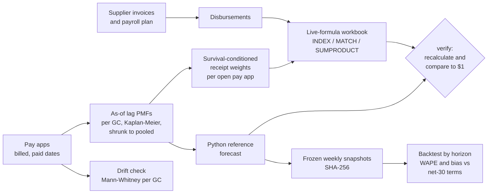

# thirteenweek

[](https://github.com/SlateGitOrg/thirteenweek/actions/workflows/ci.yml)


A 13-week direct cash forecast for a commercial electrical subcontractor, written as a live-formula Excel workbook. Receipts are not assumed to arrive on contract terms: each general contractor's pay lag is estimated from what has actually been paid, open pay applications are conditioned on how long they have already waited, and the whole forecast is recalculated with `formulas` and checked against a plain-Python reference. Every forecast is frozen as a hashed weekly snapshot, and a backtest scores it at each horizon against the contract-terms method that the lender's template uses. All data is synthetic and generated from a seed.

## The problem

The company bills general contractors (GCs) monthly through pay applications, is paid when the GC gets paid, and has 10% retainage held on every application until each job closes out. The 13-week cash forecast its lender requires assumes every pay app is collected on 30-day terms. In practice the GCs pay with median lags of 32 to 75 days, so near-term receipts are overstated and revolver draws arrive as surprises. The forecast file is also overwritten every week, so nobody can say how wrong it was four weeks ago.

This repository rebuilds the forecast so that receipts follow each GC's observed lag, the file records what the forecast said on the day it was made, and the error is measured at every horizon from 1 to 13 weeks.

## How it works



* A pay app's lag bin is `ceil(lag_days / 7)`: bins 0 to 30 plus "beyond". Per-GC PMFs come from apps billed in the 78 weeks before the as-of date, using only payments known on that date. A GC with fewer than 8 paid apps is shrunk toward the pooled PMF with weight `n / (n + 8)`.
* An open pay app aged `a` whole weeks is known to have lag `>= a + 1`. Its expected receipt in week `k` is `amount x pmf(a + k) / S(a + 1)`, and the amount still unpaid after week 13 is `amount x S(a + 14) / S(a + 1)`. The 13 weeks plus "after week 13" add back to the open amount to the cent. An app with `S(a + 1) = 0` is older than any lag observed for its GC and goes to the `Disputed` sheet with no receipts.
* Retainage is a single expected receipt in the week of substantial completion plus the GC's median historical retainage lag. Retainage on jobs that finish after the horizon goes to "after week 13".
* The workbook has the sheets `Inputs`, `LagPMF` (values), `Survival` (cumulative-sum formulas), `OpenAR` (one row per open pay app or retainage item, 13 week columns of INDEX/MATCH formulas), `Disputed`, `Disbursements`, `Forecast` and `Checks`. Lower-tier subcontractor payments are each job's subcontract share times that job's forecast receipts, one week later.

## Quick start

```bash
python3 -m venv .venv && . .venv/bin/activate
pip install -e ".[dev]"

thirteenweek generate --seed 7 --out data/
thirteenweek lags --as-of 2026-03-06
thirteenweek build --as-of 2026-03-06 --out out/cash13.xlsx
thirteenweek verify out/cash13.xlsx
thirteenweek backtest --weeks 26
thirteenweek drift --as-of 2026-03-06

# stress case: G09 four weeks later still, lower opening cash
thirteenweek build --stress --out out/cash13-stress.xlsx
```

`build` also freezes `snapshots/<as-of>.json` and refuses to overwrite an existing snapshot unless you pass `--force`. A `data/` directory generated with seed 7 is committed so the commands above work without running `generate` first.

## Example output

All of this was produced by running the commands above on the seeded data (594 pay apps, 30 jobs, 14 GCs, 401 supplier invoices).

`thirteenweek build --as-of 2026-03-06` (base case: 66 open items plus 1 disputed item of $309,392 excluded; $8,327,587 of expected receipts fall after week 13, mostly retainage on jobs that finish later):

```
Wk  Ending        Receipts    Disburse         Net        Draw       Repay    End cash   Liquidity  Covenant
 1  2026-03-13   1,118,262     694,194     424,068           0     500,000     923,275   2,523,275  ok
 2  2026-03-20   1,121,420     841,667     279,753           0           0   1,203,028   2,803,028  ok
 3  2026-03-27     746,974     856,063    -109,089           0           0   1,093,939   2,693,939  ok
 4  2026-04-03     924,281     870,948      53,333           0           0   1,147,272   2,747,272  ok
 5  2026-04-10   1,278,210     677,682     600,528           0           0   1,747,800   3,347,800  ok
 6  2026-04-17     946,754   2,254,254  -1,307,501     309,700           0     750,000   2,040,300  ok
 7  2026-04-24   1,261,653     723,619     538,034           0     309,700     977,842   2,577,842  ok
 8  2026-05-01     344,862     566,349    -221,486           0           0     756,356   2,356,356  ok
 9  2026-05-08     566,111     342,034     224,077           0           0     980,433   2,580,433  ok
10  2026-05-15     210,719     397,250    -186,531           0           0     793,902   2,393,902  ok
11  2026-05-22     921,277     321,249     600,028           0           0   1,393,930   2,993,930  ok
12  2026-05-29      65,826     568,837    -503,010           0           0     890,920   2,490,920  ok
13  2026-06-05      40,462     289,003    -248,541     107,621           0     750,000   2,242,379  ok
```

The $1.2M switchgear invoice due in week 6 is the first thing that pushes pre-revolver cash below the $750,000 minimum, so the first draw is in week 6. Receipts fall away after week 8 because the forecast is a run-off of receivables that are open on the as-of date, against full payroll and open supplier invoices, with no future billings. Revolver draws after about week 8 (for example the $107,621 in week 13) are artifacts of the missing billings and are not meaningful; the near-term weeks, and the week-6 switchgear squeeze, are the part to read.

`thirteenweek build --stress` (G09 four weeks later, opening cash $250,000): the revolver is exhausted and the liquidity covenant ($1,000,000) is breached in week 6.

```
Wk  Ending        Receipts    Disburse         Net        Draw       Repay    End cash   Liquidity  Covenant
 5  2026-04-10   1,261,546     654,461     607,085           0     605,467     750,000   1,935,316  ok
 6  2026-04-17     867,299   2,249,588  -1,382,289   1,185,316           0     552,369     552,369  BREACH
 7  2026-04-24   1,251,811     702,394     549,418           0     349,248     750,000   1,099,248  ok
```

`thirteenweek verify out/cash13.xlsx`:

```
base scenario as of 2026-03-06: compared 169 Forecast cells, largest difference $0.0000
Checks sheet: all pass
OK: workbook matches the reference within $1
```

`thirteenweek backtest --weeks 26` (26 weekly origins; each is scored on the receivables open at that origin, using data known at that origin only; `t-ex` is the contract-terms method with past-due items left out):

```
Horizon  Actual $k  WAPE lag  Bias lag  WAPE terms  Bias terms  WAPE t-ex  Bias t-ex
      1     40,618     27.7%     -7.0%      369.9%     +369.9%      46.9%     -13.3%
      2     40,332     28.8%     -1.4%       39.3%       -4.3%      39.3%      -4.3%
      3     40,507     28.6%     -3.2%       39.1%       -4.4%      39.1%      -4.4%
      4     39,566     28.6%     -0.1%       40.9%       -4.0%      40.9%      -4.0%
      5     34,852     29.6%     +8.8%       65.2%      -54.3%      65.2%     -54.3%
      6     28,222     37.7%    +15.6%       90.0%      -88.8%      90.0%     -88.8%
      7     22,696     44.1%     +9.9%       90.4%      -86.0%      90.4%     -86.0%
      8     18,627     49.7%     +4.9%       88.2%      -83.1%      88.2%     -83.1%
      9     15,281     60.8%     +4.2%       85.6%      -79.4%      85.6%     -79.4%
     10     11,956     64.5%     +4.6%       81.8%      -73.9%      81.8%     -73.9%
     11     10,104     75.1%     -5.1%       87.3%      -69.6%      87.3%     -69.6%
     12      9,248     70.2%    -15.7%       82.8%      -70.2%      82.8%     -70.2%
     13      7,446     95.9%    -26.1%       94.1%      -63.2%      94.1%     -63.2%
```

Read this per horizon. The terms method over-forecasts only in week 1 (+370%); from week 2 on it under-forecasts (about -4% in weeks 2 to 4, and -54% to -89% from week 5, because net-30 collects nothing that late). The week-1 spike is past-due accumulation: the baseline puts every open app that is already past 30 days, including the never-paid $309k J17 app, into week 1. Leaving past-due items out (`t-ex`) removes it (week-1 bias -13.3%, WAPE 46.9%), and the pay-lag method (27.7%) still has the lower WAPE. The pay-lag method has lower WAPE than both terms variants at every horizon from 1 to 8 and a bias within about 16% at horizons 1 to 12 (-26% at horizon 13). At horizon 13 it is no better than the terms method (95.9% against 94.1%): few receivables remain that far out and the tail is hard to place. Pooled over horizons 1 to 8 the terms method's cumulative bias is +24.9% against +2.2% for the pay-lag method, but that is a sum of a large week-1 over-forecast and later under-forecasts, not a per-horizon property.

`thirteenweek drift --as-of 2026-03-06`:

```
pay-lag drift as of 2026-03-06: apps billed 13-26 weeks ago vs 27-78 weeks ago (one-sided Mann-Whitney, Benjamini-Hochberg q = 0.05, median shift >= 10 days)
GC    n recent  n ref  median recent  median ref  shift (d)         p     p adj  flag
G09         16     59           70.0        49.0      +21.0    0.0000    0.0001  DRIFT
G01         12     47           38.0        37.0       +1.0    0.3672    0.6319  
G03          9     36           46.0        46.0       +0.0    0.4212    0.6319  
G04          6     24           67.0        60.0       +7.0    0.2930    0.6319  
G05          7     23           30.0        35.0       -5.0    0.8993    0.9543  
G08          6     24           31.0        44.5      -13.5    0.9543    0.9543  
flagged: G09
```

GCs with fewer than 5 recent or 5 reference apps are not tested. G09 is the injected pay-lag drift (+21 days on every application billed in the final 26 weeks); the other tested GCs are not flagged.

## Design decisions

* **Kaplan-Meier lag distributions, not a histogram of paid apps.** Slow payers are exactly the apps still unpaid, so a histogram of paid apps is biased toward short lags. Unpaid apps are right-censored observations in a discrete product-limit estimator. The cost is that the estimate ends at the longest observed paid lag: mass after it is unidentified, so the last observed bin takes the remaining probability. That is what makes "older than any observed lag" a well-defined zero-survival state, but it also means one unusually late payment extends a GC's tail, and an aged app can be forecast as certain to be paid in that final bin.
* **Receipts are a run-off of what is open, and the backtest scores the same thing.** The forecast contains no future billings, so later weeks are understated as a cash forecast. Scoring on the receivables open at each origin keeps the comparison with the terms method fair and avoids charging either method for billings it never saw. The consequence is that the table measures receipt timing, not total cash adequacy; week 1 lower-tier payments are zero because the prior week's receipts are not in the data.
* **Interest on the prior week's revolver balance.** Interest in week `t` is `round(outstanding(t-1) x rate / 52, 2)`, so there is no circular reference between interest, draw and ending cash. Within a week the draw can slightly understate interest on balances drawn that week.
* **A narrow formula whitelist and a Python reference.** The workbook uses only SUM, SUMPRODUCT, IF, MIN, MAX, ROUND, ABS, INDEX, MATCH, AND and OR; no OFFSET, INDIRECT, TODAY or data tables. The PMFs are values (an estimate, not a calculation a user should edit); everything downstream is formulas. `verify` recalculates with `formulas`, which is slower than Excel and supports only a subset of functions, but runs in CI with no Excel installed.
* **Snapshots are frozen and hashed.** Each snapshot records the inputs, the open items and every forecast line with a SHA-256 of that content, and `build` will not replace one without `--force`. The look-ahead test builds the same snapshot from the full dataset and from a copy with later rows removed and later payment dates blanked, and requires them to be identical.
* **Drift uses conservative censoring.** An unpaid app enters the Mann-Whitney comparison at its current age, which can only understate its eventual lag. A GC must pass both the Benjamini-Hochberg threshold (q = 0.05) and a 10-day median shift, so a statistically detectable but commercially trivial shift is not flagged.

## Testing

```bash
pytest -q
```

87 tests, offline and deterministic. They cover: the survival fixture (PMF 0.1 / 0.2 / 0.3 / 0.4 and an app aged one week gives weights 3/7 and 4/7), Kaplan-Meier censoring, shrinkage weights, conservation of every open item to the cent, the disputed J17 app, the base-case week-6 draw and the stress-case week-6 covenant breach, a formula whitelist and no-error scan of the workbook, `formulas` recalculation equal to the reference for every Forecast cell in both scenarios, the backtest ordering (pay-lag WAPE below both terms variants at horizons 1 to 8, the terms week-1 over-forecast disappearing once past-due items are excluded), a no-look-ahead test that rewrites every later-dated field (later billings, payments, invoices, retainage dates, jobs not yet started, payroll beyond the horizon) and requires an identical snapshot, alongside the truncation comparison, Benjamini-Hochberg known values, G09-only drift, and the CLI including snapshot refusal and tampered-workbook detection.

## Project layout

```
src/thirteenweek/
  models.py      records, constants, the as-of truncation rule
  generate.py    seeded synthetic dataset with injected patterns
  dataio.py      CSV / JSON reading and writing
  lags.py        Kaplan-Meier PMFs, shrinkage, survival, stress shift
  receipts.py    open items, survival-conditioned weights, terms baseline
  reference.py   the forecast in Python, snapshot payload and hash
  workbook.py    openpyxl workbook with live formulas
  verify.py      recalculation with formulas and comparison
  backtest.py    WAPE and bias by horizon
  drift.py       per-GC Mann-Whitney with Benjamini-Hochberg
  snapshot.py    frozen snapshot files
  cli.py         typer commands
tests/           pytest suite
data/            seed-7 dataset (CSV, inputs.json, truth.json)
```

## License

MIT
